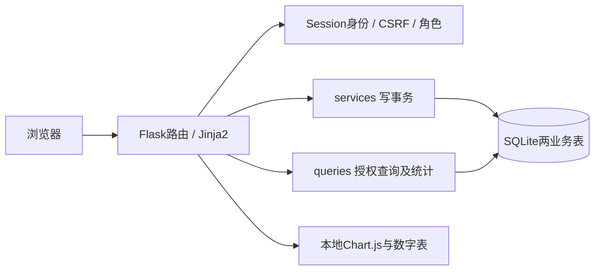
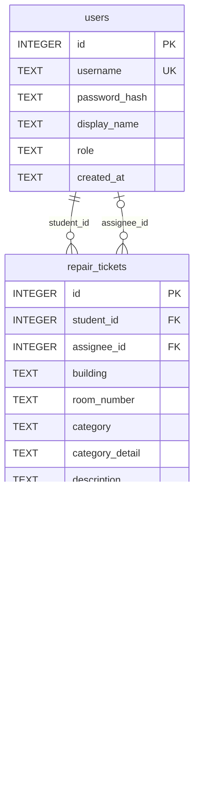
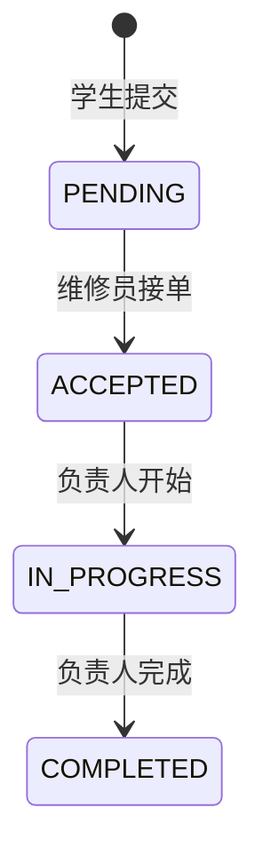

# 宿舍报修管理系统开发设计

《企业级 AI 软件设计与开发》综合实践第8题；Phase5交付复核版，2026-10-23。Phase0–4已获用户阶段审核，Phase5验收和材料准备等待最终人工审核。原始对话、真实视频未齐全前，不称全部交付完成。

## 1. 需求依据与范围

正式依据是开发机 `宿舍保修管理系统工作说明/sources/综合实践项目选题与验收标准.docx`。本轮重新提取正文并读取内嵌评分图片，与整理表九项合计100分一致。原始教师材料保留本地，不是应用运行或默认公开分发的依赖。

| 来源 | 内容与边界 |
|---|---|
| 老师正式Word | 报修、列表详情、接单、状态更新、确认评价、类型/状态查询；合理流转及终态保护；至少一种真实统计；空报修/重复接单/非法跳转/无效评分提示；可运行、持久化、README和视频 |
| 课堂整理，未重新取得录音 | 五类材料、独立完成、学号+姓名压缩包、2026-10-30之前、邮箱提交；准确邮箱与截止时刻待正式通知 |
| 用户批准的工程选择 | Flask/SQLite单体、两角色四账号、四状态、确认后1–5整数评价、两张统计图、分页20条、CSRF、幂等Token和隐私404 |

可选AI扩展不是必做，不实现LLM、智能派单、多智能体、注册、管理员后台、图片上传、通知或支付。实际功能验收与代码证据见 `docs/ACCEPTANCE_RESULTS.md`；A编号为工程验收编号，不冒充教师原始测试集。

## 2. 实际架构与职责

| 实际文件 | 职责 |
|---|---|
| run.py、app/__init__.py | Application Factory、环境配置、扩展和错误处理 |
| app/db.py、schema.sql | 每请求连接/关闭、外键、版本检查、建库与种子CLI、两表约束 |
| app/auth.py | 登录、密码散列验证、Session ID轮换、退出失效、角色装饰器 |
| app/tickets.py | 报修表单、列表详情、五种POST动作、北京时间显示 |
| app/services.py | 创建幂等、动作权限/前置状态、原子更新及事务回滚 |
| app/queries.py、constants.py | 统一枚举、授权范围、参数解析、分页及同快照统计 |
| app/dashboard.py | 登录保护统计页，复用列表筛选上下文 |
| templates/、static/ | Jinja转义、角色导航、状态提示、自有CSS、Chart.js本地资源 |
| tests/、scripts/ | 独立期望测试、真实HTTP和进程重启、全新环境复现 |
| docs/、ai_evidence/ | 实际验收、交付缺项、演示脚本和真实过程记录 |

没有ORM、Redis、消息队列或前端构建系统。实际使用自有响应式CSS，没有引入Bootstrap；早期设计中的Bootstrap建议已按实现校正。

## 3. 数据库ER和字段

一个学生有多单，一单必须有一个学生；维修员可负责多单，一单至多一个负责人。Session存在服务器文件，不新增业务表。评价直接存工单表，一单一次，不新增评价表。

| 表/字段 | SQLite类型与实际限制 |
|---|---|
| users.id | INTEGER PRIMARY KEY |
| username | TEXT NOT NULL UNIQUE，trim长度1–50 |
| password_hash | TEXT NOT NULL，长度>20，应用生成Werkzeug散列 |
| display_name、role、created_at | TEXT NOT NULL；展示名trim长度1–50；role为student/repairer；创建时间长度>=20 |
| repair_tickets.id、student_id | INTEGER主键；学生ID非空外键users(id)，删除RESTRICT |
| assignee_id | 可空INTEGER外键，非空时不能等于student_id，删除RESTRICT |
| building、room_number、description | TEXT NOT NULL，数据库trim长度1–30/1–20/5–1000；请求层strip处理Unicode空白 |
| category、status | TEXT NOT NULL；类别为原有照明/水管/门锁/网络，加本体类、电类、电梯类、道路景观类、给排水类、空调类、开水饮水类、门窗五金类、暖气类、洗浴热水类、消防设施类及其他；状态四枚举，默认PENDING |
| category_detail | 可空TEXT；只允许category=其他时非空，trim后1–50字符。新建选择其他必须填写；历史其他工单可以保留NULL |
| created_at、updated_at | TEXT NOT NULL；其余assigned/started/completed/confirmed/reviewed时间可空 |
| rating | 可空INTEGER，非空时typeof为integer且1–5 |
| review_text | 可空TEXT；非空须已评分且trim后1–500字符；请求空短评存NULL |
| submission_token | TEXT NOT NULL，UNIQUE(student_id,submission_token) |

跨字段CHECK要求：PENDING无负责人及维修时间；ACCEPTED有负责人/接单时间且无开始完成时间；IN_PROGRESS已有开始时间但无完成时间；COMPLETED拥有所有维修时间。确认必须COMPLETED，评分必须已确认；评分与reviewed_at同空或同非空。updated_at>=created_at；已有阶段时间满足创建≤接单≤开始≤完成≤确认≤评价。schema未额外约束每个节点<=updated_at，应用在同一次更新保证更新时刻；不夸大数据库CHECK能力。

数据库外键只验证用户存在，角色、历史流转与权限由服务端检查。当前没有用户角色修改接口。固定UTC ISO格式含微秒/Z，展示转UTC+8，不能信任前端时间。

索引为username唯一、学生+创建时间+ID、负责人+创建时间+ID、状态+创建时间+ID以及提交标识组合唯一。当前PRAGMA user_version=2，每连接外键ON、busy_timeout=5000。未知版本或已有未知结构拒绝初始化；相同版本检查必要表和category_detail列，但不宣称完整列签名校验。重复初始化/种子保持历史；种子不重置已有密码或灌入工单。旧版本1必须显式执行migrate-db，不能通过init-db假装已升级。

## 4. 身份、权限与安全

Flask-Session 0.8.0通过CacheLib文件存储保存服务端会话；Cookie仅携带随机Session ID。每请求从users读取角色，登录成功regenerate，退出删除服务器会话。会话有效2小时；HttpOnly、SameSite=Lax，本机HTTP不设Secure，HTTPS需显式开启。

SECRET_KEY优先从环境取，否则在instance生成并复用随机值；数据库与Session路径可配置，测试覆盖默认路径隔离。应用不自动读.env，不把配置建议写成已实现配置文件加载器。

| 主体 | 查询范围 | 合法写操作 |
|---|---|---|
| 学生 | student_id=本人，所有状态 | 创建本人单；完成后本人确认，再一次性评价 |
| 维修员 | (PENDING且无人负责) OR assignee_id=本人 | 接单；本人负责且状态符合时开始/完成 |
| 未登录 | 首页、登录、health | 登录；业务写操作不允许 |

角色、归属、状态检查都在后端。前端按钮仅改善体验。任何student_id/assignee_id/status/时间伪造字段均不作为可信身份来源；非预期字段拒绝。

CSRFProtect覆盖全部POST：缺失/无效优先400；合法CSRF后未登录业务POST401，错角色403。未登录受保护GET302登录；不存在/无权访问工单404；仍可见的业务状态冲突409；非法输入400；写存储失败503并回滚。已被他人接走从当前范围消失返回404，避免泄露负责人；本人重复接自己的单返回409。所有写路径GET405，成功提交后303。

SQL用户值均绑定参数；动态列名只取代码常量；Jinja自动转义，统计用tojson，不把描述当HTML。没有向客户端公开数据库路径、密钥或密码。

## 5. 状态机、确认和评价

| 当前状态/条件 | 操作者与动作 | 写入 |
|---|---|---|
| PENDING且无负责人 | 维修员accept | ACCEPTED、assignee_id、assigned_at、updated_at |
| ACCEPTED | 负责人start | IN_PROGRESS、started_at、updated_at |
| IN_PROGRESS | 负责人complete | COMPLETED、completed_at、updated_at |
| COMPLETED且未确认 | 原学生confirm | confirmed_at、updated_at，状态不变 |
| 已确认且未评价 | 原学生review | rating、可选review_text、reviewed_at、updated_at，状态不变 |
| 已评价 | 无业务写操作 | 只读 |

维修完成由维修员声明；学生确认表示认可完成；确认后评价反馈质量。确认/评价是完成后的字段，不是新状态，所以COMPLETED统计不被拆散。拒绝跳级、回退、再次接单、重复确认或覆盖评价。请求评分只接受原始字符串1至5，拒绝1.0、1.5、布尔、空值、文字及越界；短评strip后<=500。

## 6. 核心接口

| 方法与路径 | 用途/权限 |
|---|---|
| GET /、/health | 首页、数据库连接/版本健康 |
| GET/POST /login、POST /logout | 登录及退出，POST带CSRF |
| GET /portal | 登录身份入口 |
| GET/POST /tickets/new | 学生创建表单/提交 |
| GET /tickets | 学生本人列表及统计 |
| GET /work-queue | 维修员可见工单及统计 |
| GET /tickets/<id> | 授权详情 |
| POST /tickets/<id>/accept、/start、/complete | 维修角色，且满足归属和状态 |
| POST /tickets/<id>/confirm、/review | 原学生，且满足完成/确认前置 |
| GET /dashboard | 登录用户授权范围内统计 |

所有列表/统计只接受category/status/page三个白名单参数，重复、未知枚举或非法页码400。不存在任意status写入接口。

## 7. 事务、幂等与并发

创建GET签发与Session绑定的submission_token，保留最近10个。POST合法后在BEGIN IMMEDIATE事务中查询同学生+标识，存在且规范化内容相同则返回原单，内容不同409；不存在则插入PENDING后提交。唯一约束兜底。非法表单不消耗标识，成功303实现PRG；CSRF和submission_token分别防伪造与防重传，不混用。

状态动作在BEGIN IMMEDIATE内检查可见范围和前置条件，并执行条件UPDATE。例如接单WHERE id=? AND status='PENDING' AND assignee_id IS NULL，rowcount必须1；开始/完成另含assignee_id，确认/评价含student_id及未确认/未评价条件。SQLite同文件写锁和条件谓词保证竞争时只有一名有效接单者，不能SELECT后无条件覆盖。

所有相关字段用同一服务器时间、同一UPDATE写入，COMMIT成功才反馈成功；状态校验、约束或SQLite异常ROLLBACK，锁超时/写存储故障503。测试注入UPDATE后/提交失败验证全行不变。并发使用同一临时文件库、独立连接、屏障，不用两个不共享的内存库冒充竞争。

## 8. 筛选、分页和统计

visible_scope生成授权谓词，追加category/status绑定参数的AND条件。学生本人；维修员“待接或本人负责”用括号整体与筛选相交。固定类别/状态补零，不聚合无权限记录。

同一请求在同一显式SQLite读事务内执行COUNT、ORDER BY created_at DESC,id DESC的20条页、两组GROUP BY。统计不加LIMIT；总数等于所有类型数量之和，也等于所有状态数量之和。测试在隔离WAL库中于多次SELECT之间提交并发写，确认请求内部仍使用同一快照；生产日志模式不改为WAL。

分页保留条件，应用筛选不带旧page，清空条件恢复全部授权记录。无匹配是全零+空提示，超出最后页有返回导航。刷新创建/维修状态后看到新的已提交分布；确认/评价不改变COMPLETED；其他维修员接走后该记录和数量一起退出当前维修员范围。

本地Chart.js 4.5.1绘制类型柱状图和状态环形图，使用显式枚举顺序、同一服务端JSON，始终提供数字表。官方npm来源、SHA校验及MIT许可证在vendor README和Phase4记录，无CDN运行依赖。图表实际浏览器渲染的证据与HTTP/pytest分开记载。

## 9. 测试、交付与人工决定

本轮在全新目录、新虚拟环境、无缓存安装后运行Phase1–4全部pytest和两个真实HTTP脚本；最终实际输出以 `ai_evidence/phase5/` 和 `docs/ACCEPTANCE_RESULTS.md` 为准。独立HTTP不导入业务服务，使用固定输入、真实请求与sqlite3逐行核验；真实停止/重启进程后重新登录比较全字段。

人工选择与AI协作：用户分阶段批准；Phase0审核修订CSRF/身份优先级和404隐私边界；要求预置账号但真实服务端Session；批准四状态、两表、确认字段与两种统计。真实问题、Prompt、验证方法、已知历史哈希见 `docs/AI_PROCESS_INDEX.md`。阶段记录不是完整聊天导出，未收到用户记录不伪造人工操作或成绩。

保留两业务表、四状态和单机应用，避免为课程引入复杂管理后台。限制包括缺少返修/取消/用户注册/迁移平台/完整审计；SQLite不是多节点生产平台。代码可运行不代表视频、原始对话和最终提交已完成。

## 13. 变更记录

| 日期 | 来源 | 变更 |
|---|---|---|
| 2026-10-23 | 用户 Phase 0 独立审核 | Phase 0 通过并批准 Phase 1；根目录新增 AGENTS.md/PLANS.md，资料包原件保留，文档引用改为实际路径。 |
| 2026-10-23 | 用户 Phase 0 独立审核 | 固定 CSRF/认证顺序：无效 CSRF 400，合法 CSRF 后未登录401、错角色403；测试不得关闭 CSRF。 |
| 2026-10-23 | 用户 Phase 0 独立审核 | 收紧接单隐私：不可见或已被他人接走返回404；当前仍可见的业务冲突返回409；并发验收固定失败码且重点验证唯一成功与数据不变。 |
| 2026-10-23 | 用户批准 Phase 2 | 实现学生提交、幂等 Token、本人列表、20 条分页和权限隔离详情；维修人员可见范围提供只读 `/work-queue`，未加入任何接单或状态写操作。 |
| 2026-10-23 | Phase 2 实际验证 | 首轮 Phase 1+2 回归为 38 passed，补充边界后最终回归为 42 passed；真实进程 HTTP 创建、跨学生 404 和停止重启后持久化通过。浏览器自动化因 Work 设置禁用本地浏览器而未验证。 |
| 2026-10-23 | 用户批准 Phase 3 | 沿用四状态及现有两表，增加 accept/start/complete/confirm/review 五个 POST 动作和对应页面。所有更新带当前状态、负责人或学生归属前置条件，成功提交后才 303。 |
| 2026-10-23 | Phase 3 验收预期核对 | 资料包矩阵 A15 的“业务冲突提示”是笼统表述，按已批准 3.3 节固定为：他人接走/不可见404，本人可见重复动作409。fixture S05/S09 只要求拒绝及数据不变，并未指定冲突 HTTP 码，无需改动原件。 |
| 2026-10-23 | Phase 3 事务实施 | BEGIN IMMEDIATE 内检查可见性和状态，再执行条件 UPDATE，以 rowcount=1 与 COMMIT 成功判定成功；同一事务内生成服务器 UTC 时间，异常回滚。并发确认/评价同样条件更新。详情显示维修员展示名、北京时间、确认及评价。 |
| 2026-10-23 | Phase 3 实际验证 | 最终全量62 passed；三种真实双连接竞争及五种动作的事务故障回滚通过。隔离真实 HTTP 闭环、新进程重启后的全字段一致性通过。浏览器工具仍被设置禁用，桌面/手机人工检查未验证。 |
| 2026-10-23 | 用户批准 Phase 4 | 保留两表、四状态、已批准权限范围。学生列表、维修工作台及 `/dashboard` 共用授权和类型/状态 AND 条件、20 条分页、两种真实统计。未增加任何业务状态或管理角色。 |
| 2026-10-23 | Phase 4 查询实施 | `constants.py` 统一枚举，`parse_filters` 白名单校验参数；`ticket_overview` 同一显式 SQLite 读事务内完成总数、列表、两组 GROUP BY，统计不加分页 LIMIT。缺失类别/状态补零；数字表及本地 Chart.js 4.5.1 展示同一结果。 |
| 2026-10-23 | Phase 4 实际验证 | 基线62 passed，专项9 passed，最终71 passed；真实 HTTP 筛选、权限范围统计、状态分布及新进程重启通过。隔离 WAL 测试验证读快照一致性；不修改运行库日志模式。浏览器工具被 Work 设置禁用，实际图表绘制、桌面/390px视觉仍未验证。未提交或推送。 |

| 2026-10-23 | 用户批准Phase5及实际审查 | 按最终代码整理设计，校正未使用Bootstrap、版本检查范围、时间约束及fixture适配的规划措辞；保留历史记录。执行干净环境与独立HTTP验收，结果另见实际证据；不自动提交或推送。 |
| 2026-10-23 | 用户批准独立Phase4.5 | 升级布局、概览、表单、列表、详情时间线和图表外观；复用授权查询，新增只读本人负责列表。基线72项、最终80项pytest通过；部分1440px浏览器检查有真实截图，其余视觉项明确待验。不改变业务写服务、认证、数据库及四状态。 |

## 14. Phase 4.5 最终界面设计

### 14.1 实施边界与视觉参考

本轮由用户单独批准，只改善界面与只读信息呈现。参考 [Tabler垂直布局](https://tabler.io/admin-template/preview?page=layout-vertical.html) 和 [官方组件文档](https://docs.tabler.io/ui) 的侧栏、卡片与信息密度，不复制示例业务。已核对Tabler的MIT许可和基于Bootstrap的技术背景；没有引入Tabler包，也没有复制其模板、CSS或图标资源。

实际项目此前使用自有CSS而非Bootstrap。本轮继续原有Jinja2与CSS体系，避免引入另一份基础样式造成冲突。没有新增前端构建工具或CDN依赖；Chart.js继续使用本地4.5.1文件及原MIT许可证。线性SVG由本项目模板宏生成，不依赖外部图标字体。

主色#2563EB，深蓝#182D49，背景#F5F7FB，白卡片，主文字#172B4D、次文字#64748B、边框#E2E8F0；成功/警示/错误分别#16A34A/#D97706/#DC2626。圆角12px、轻阴影，以8px间距为主；字体适配Segoe UI、微软雅黑、苹方与系统中文。

### 14.2 布局与组件

- 登录后：240px侧栏、顶部身份栏、紧凑页面标题、白色内容卡片。学生导航为工作概览、我的报修、提交报修、工单统计；维修员为工作概览、待接工单、我负责的工单、工单统计。
- 991px及以下：菜单抽屉、遮罩、Escape关闭、键盘焦点循环与关闭时不可聚焦；不支持或关闭JS时保留可访问的静态导航。720px以下表单与内容改为单列，指标为两列；宽表格在容器内滚动。
- 未登录：首页用品牌、简短价值说明及真实流程说明替代巨大标题和空卡片；登录页使用独立品牌区和表单卡片。
- 表单：位置字段分组、必填说明、字段旁错误、aria-invalid/describedby；CSRF与submission_token原样保留，服务端幂等仍是重复提交保护。
- 列表：筛选工具栏、统一状态色、清晰表头、紧凑详情入口、分页与空状态。列表统计可展开查看，独立统计页默认完整呈现。
- 详情：保留全部真实信息和合法业务动作，增加六节点时间线。仅当相应created/assigned/started/completed/confirmed/reviewed时间实际存在时标为已发生，其他显示“尚未发生”。确认、评价仍不是新增状态。
- 图表：类型柱状图显示数量，状态环形图使用语义颜色与中心总数；保留全部数字表、零数据占位和本地脚本。图表取数与枚举顺序未改变。

### 14.3 授权只读数据复用

`pages._render_portal`复用`queries.ticket_overview`，获取同一授权范围的快照、总数、状态汇总及最近5条。学生摘要为累计/待处理/维修中/已完成；维修员为待接/本人已接/本人维修中/本人已完成。各状态卡不被描述为覆盖全部状态的分项合计，累计值仍来自全范围COUNT。

新增只读`GET /my-work`供维修员查看本人负责记录。`ticket_overview`仅增加`assigned_only`可选条件，将`assignee_id = 当前用户ID`与原授权谓词和筛选AND相交；不接受前端负责人ID。仍用同一读事务获取分页、总数与两组统计。`/work-queue`原有“待接或本人负责”契约不变；侧栏待接入口使用已有`status=PENDING`筛选。没有新增业务写接口。

### 14.4 实际验证与待验

修改前全量72 passed in 153.04s；修改后全量80 passed in 217.84s。新增固定数据测试覆盖四账号概览、只读查询不改库、本人负责范围与分页统计、角色和参数保护、真实时间线及表单/静态资源。既有测试未修改。

独立真实HTTP脚本退出0，完成创建至评价、19次非法操作拒绝与全行不变、筛选统计、本地资源和停止重启持久化。JS语法和Python编译检查通过。

本轮实际浏览器已检查1440px首页、登录、学生空概览、表单字段错误及合法创建后的详情结构；四张截图在`ai_evidence/phase4_ui/`。工具随后报本地浏览器被Work设置禁用。1366/768/390px、新版维修端与统计图实际绘制等仍为NOT_VERIFIED，不能引用旧UI的Phase5截图代替。逐页人工核验清单见`docs/UI_MANUAL_CHECKLIST.md`。详细真实失败及修复见`ai_evidence/phase4_ui.md`。

## 15. 用户补充：报修类型扩展与其他文字

2026-10-23用户提供报修类型截图，明确要求加入图中类别、选择其他后出现文字输入框。这是用户新需求，不冒充老师规定的类别清单；在此前纯UI阶段之后，授权对该字段及必要持久化做最小扩展，认证、角色和状态机不变。

保留原照明/水管/门锁/网络，新增本体类、电类、电梯类、道路景观类、给排水类、空调类、开水饮水类、门窗五金类、暖气类、洗浴热水类、消防设施类，加其他共16项。表单、查询白名单和统计统一从constants读取；旧有五项统计预期保留，再独立补充十一项零值预期，不减少原断言。

“其他”对应category='其他'，category_detail单独保存trim后1–50字的具体类型。服务端要求新建其他时必填；非其他却提交该字段拒绝400。JS只控制就地显示、必填、焦点和禁用，不能代替服务端校验。无JS时输入框保留可访问并有条件填写说明。详情、列表和最近记录显示并转义自定义文字；统计不将自由文字扩散为任意分类，统一算其他。旧记录的NULL允许保留，不编造历史类型。

幂等比较包含category_detail，规范化后相同Token/相同文字返回原单，修改文字返回409；非法表单不消耗Token。新增字段与工单同一INSERT事务保存。

数据库版本2扩展类别CHECK及category_detail CHECK；新库init-db直接建2，旧库init-db拒绝悄悄升级。显式migrate-db先备份，再BEGIN IMMEDIATE内新建兼容表、按原字段复制、逐行核对、替换旧表、恢复三索引、检查外键、设置版本并提交；异常整笔回滚。所有账号、工单原ID/状态/负责人/时间/评分/Token保留。重复升级无操作；未知版本、字段或自定义索引/触发器拒绝。执行前停止Web进程，使用同一数据库配置，之后重启并强刷资源。未自动改动使用者运行库；操作见README。

新用例覆盖十一类真实提交与过滤、其他空白/长度/转义/幂等/归类、完整版本1工单保留和备份、升级中途故障回滚。全量84 passed in 308.95s，显式关闭备份连接后专项4 passed in 10.00s。两套真实HTTP脚本退出0，分别验证完整闭环及其他输入、数据库字段和重复请求。实际命令、Windows脚本清理问题及浏览器待验详见ai_evidence/category_extension.md。

## 16. 2026-10-26最终收尾

用户授权完成剩余升级、验证、文档和版本保存。实际对默认运行库执行migrate-db，保留4账号、原工单字段和备份，旧库当时0单；不写演示单。独立浏览器库真实创建家具损坏和空调两单，完成家具单全部四状态/学生确认/5分评价，进程停止重启后用新HTTP会话逐行核对持久化与四账号授权范围。

浏览器本轮可用期间记录1440桌面和390手机截图，验证其他输入框显隐、必填、切走禁用，以及手机菜单Escape/遮罩/焦点循环。四视口长描述详情DOM宽度均未溢出；不能把DOM宽度检查写成全部页面四视口视觉通过。

实际发现16类纵向图表拥挤、截图停留在绘制过渡状态。图表改indexAxis=y、每类28px自动高度、全部类别标签、条尾数值，关闭动画以直接呈现最终位置；两图统计数据不变。Node配置回归固定16类及2单期望，验证配置和数值，不能模拟视觉结论。浏览器随后被Work设置禁用，图表修复后的真实渲染仍待本人验收。图表初始问题截图保留，不用修改后的脚本冒充已有成功截图。

干净环境首次pytest84通过但旧Phase4 HTTP脚本仍断言五类，补上十一类明确零值，旧计数/权限断言不变。WTForms是代码直接依赖，固定为本项目原有已验证3.2.2，避免新装3.3带来的接口弃用提示；不宣称冻结全部间接依赖。复现工具增加证据目录参数，避免覆盖旧阶段历史；三套真实HTTP纳入新环境复现。

最新结论在docs/ACCEPTANCE_RESULTS当前段；清单和候选包只包含安全代码、文档与证据，逐文件哈希核对，不包含运行库、备份、凭据、Session、虚拟环境或未提供的视频/原始对话。最终课程提交仍由本人补齐材料、核实正式通知并确认。用户授权本地Git保存，不自动推送或发邮件。

## 17. 界面文案精简（用户追加要求）

用户指出“真实工单”“角色权限”“幂等”“统计口径/含所有分页”等说明不适合日常操作页面。按此精简首页、侧栏、概览、登录、报修、列表、详情和统计文案：技术解释仅保留在设计与开发文档；页面保留身份、字段标签/长度、实际状态、筛选、数字、空状态及操作反馈。移除报修说明侧卡、概览底部重复说明卡、正常图表反馈和重复范围说明。表单改为单列宽度上限840px；隐藏图表反馈仅在加载失败时显示简短提示。统计授权、快照、分类和数据算法不变。

本轮实际pytest84 passed in 334.90s；独立HTTP完整闭环、19次拒绝和重启通过。浏览器实际核验1440px首页/表单/统计、390px图表、筛选/组合零结果/清空、列表统计展开折叠再展开，横向16类图与环形图均实际正常绘制，补上此前该部分待验。另发现手机表格隐藏表头绝对定位造成整页宽575px，给table-wrap增加position:relative后，整页宽恢复375/390px，表格640px仅在容器内部滚动；实际截图和记录见ai_evidence/ui_copy_cleanup.md。未变更服务端业务、旧pytest断言、数据库或原运行工单，未自动提交/推送。
