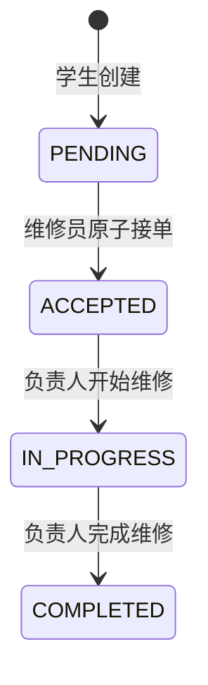

# 宿舍报修管理系统技术设计

课程：《企业级 AI 软件设计与开发》综合实践，第 8 题。日期：2026-10-23（Asia/Shanghai）。版本：Phase 4 实现记录。

**Phase 0–3 已获用户批准；Phase 4 已获实施授权并完成代理实现及自动化/HTTP 验证，等待本阶段审核。浏览器视觉检查未验证，Phase 5 尚未获授权。**

## 1. 依据、核验与项目边界

当前工作目录为项目根目录。根目录现有 `AGENTS.md`、`PLANS.md` 和 `DESIGN.md`，后续阶段以这些实际路径作为持续规则与实施基线。初始化资料原件保留在 `宿舍保修管理系统工作说明/`，下文以“资料包/”指代该目录；正式 Word 和 docs 继续使用资料包中的实际路径。不因资料包名称中的“保修”字样改变正式选题“报修”。

### 1.1 已读取的资料

完整读取资料包的 AGENTS.md、PLANS.md、sources/综合实践项目选题与验收标准.docx、docs/00–08（含演示脚本）、fixtures/acceptance_cases.json，以及 START_HERE.md、README.md、ai_evidence 下说明/模板、prompts 下阶段提示词。阶段提示词只是未来工作资料，不视作本轮执行授权。

原始 Word 的全部正文已从 OOXML 提取，保存于 `ai_evidence/phase0/official_word_text.txt`。原文只有一张内嵌图片 `word/media/image1.png`，已提取并视觉读取。图片透明背景首次显示不清，使用白底合成预览后成功读取九项评分；没有改动原 Word。九项分值及验收重点与 docs/00 整理表一致，合计 100 分；通用要求和第 8 题正文也一致。未发现影响本设计的来源冲突。正文提取不用于声称已验证 Word 排版或页码。

### 1.2 三类依据严格分开

| 标记 | 来源 | 本项目采用内容 |
|---|---|---|
| O 正式要求 | 原 Word“实践说明”“统一完成要求”“统一评分标准”及“8. 宿舍报修管理系统” | 六项必做功能、合理状态流转、终态保护、四类异常提示、至少一种真实统计、持久化、README、视频及评分 |
| C 课堂补充 | 资料包 docs/05、docs/06 的录音整理；本轮没有原始录音可复核 | 独立完成、五类材料、邮箱提交、学号+姓名压缩包、2026-10-30 之前；邮箱与准确截止时刻未核实 |
| E 工程决定 | 用户技术建议、资料包 docs/01–03、08、本设计 | Flask、SQLite、两角色、四状态、确认字段、1–5 分、两图、长度限制、原子更新等；Phase 0 已批准，不冒充教师规定 |

正式书面验收以 Word 为准。用户限制本轮只做设计，必须遵守；任何发现的验收冲突先报告，不擅自修改原材料或测试期望。AI 扩展正式明确为可选，本项目不实现自动分类、智能派单、多智能体、LLM API。

### 1.3 官方需求覆盖表

下表 O 编号为本项目追踪编号，A 编号沿用资料包验收矩阵；均为计划覆盖，非测试通过。

| ID / 官方要求 | 页面与路由 | 服务/数据职责 | 验收 |
|---|---|---|---|
| O01 学生提交报修 | GET/POST /tickets/new | create_ticket；校验类型、地址、描述，绑定会话学生，新建 PENDING | A03、A14、S01–S03 |
| O02 报修列表与详情 | GET /tickets、/work-queue、/tickets/<id> | 可见范围查询、稳定分页、真实详情和时间 | A04、A05、S15 |
| O03 维修人员接单 | POST /tickets/<id>/accept | 原子条件更新、绑定唯一负责人 | A06、A15、A21、S04–S05 |
| O04 维修状态更新 | POST /tickets/<id>/start、/complete | 负责人按顺序推进，状态与时间同事务保存 | A07、A16、S06–S08 |
| O05 完成确认与评价 | POST /tickets/<id>/confirm、/review | 所属学生先确认、再一次性评价 | A08–A09、A18–A20、S10–S14 |
| O06 按类型/状态查询 | 列表和 GET /dashboard 的 GET 查询参数 | category/status 单独或 AND 联合查询 | A10、A22、S16 |
| O07 合理顺序；完成后不能再接单或回退 | 所有状态操作接口和详情 | 四状态、禁止跳级/回退，原子前置条件 | A16–A17、S06、S09 |
| O08 至少一种统计 | GET /dashboard | 实时 GROUP BY 类型与状态；至少类型数量满足正式底线 | A11–A12、S17 |
| O09 空内容、非法跳转、重复接单、无效评分提示 | 表单、动作和错误页 | 400/409 等友好错误，业务数据不变 | A14–A18、A21 |
| O10 启动、真实功能、现场规则和数据闭环 | 全站/初始化命令/重启 | SQLite 持久化、隔离测试库、非静态演示 | A01、A03–A13、A24、S18 |
| O11 典型非法/重复/越界操作处理 | 全部受保护入口 | 登录、权限、校验、CSRF、缺失资源处理 | A14–A23 |
| O12 README、AI 使用说明、演示视频 | 交付文件 | 实测启动说明、真实开发证据、真实录屏 | A24–A27 |

Word 对统计举例“各类故障数量、状态分布、平均处理情况等至少一种”，没有要求三种都做。本设计选择类型数量、状态分布两种，不做平均维修时长，避免给缺失结束时间、统计分母引入额外口径。

## 2. 架构与目录

采用单机 Flask 服务端渲染单体：浏览器 → Flask 路由 → 身份/权限与业务服务 → sqlite3 → SQLite 文件；Jinja2 渲染页面，Bootstrap 提供布局，Chart.js 只绘制服务端聚合结果。无需前后端分离、ORM、Redis、Docker、任务队列或云服务。

两张**业务表**为 users、repair_tickets。真正的服务端 Session 用 Flask-Session + CacheLib 文件存储，放入 instance/sessions；不是 Flask 默认把会话数据放在签名 Cookie 的方式。Session 是基础设施文件，不增加业务表。具体兼容依赖版本在 Phase 1 安装、实测后锁定，不在设计阶段虚称已验证。

```text
项目根目录/
  AGENTS.md / PLANS.md              根目录持续规则与阶段门槛
  DESIGN.md                         已批准设计与变更记录
  宿舍保修管理系统工作说明/           原始资料（当前存在，保持不改）
  ai_evidence/                       真实阶段记录（Phase 0 起）
  README.md                         以下均为未来计划
  requirements.txt
  requirements-dev.txt
  .gitignore
  .env.example
  app/
    __init__.py                     application factory、配置、扩展注册
    db.py                           每请求连接、事务、版本检查、CLI
    schema.sql                      两张业务表、约束、索引
    auth.py                         登录退出、当前用户、角色检查
    tickets.py                      列表/详情/表单/动作路由
    services.py                     校验与状态动作、统一权限规则
    queries.py                      可见范围、筛选、分页、统计
    dashboard.py                    统计页路由
    templates/                      base/login/tickets/dashboard/errors
    static/css/app.css
    static/js/charts.js
    static/vendor/                  Bootstrap、Chart.js 与许可证
  instance/                        忽略提交；数据库、Session、本地配置
  tests/
    conftest.py
    test_auth.py
    test_schema.py
    test_tickets.py
    test_workflow.py
    test_concurrency.py
    test_queries_stats.py
    test_acceptance.py
  docs/                            后续实施说明、验收结果和交付清单
```

原验收 fixture 暂保留资料包位置，后续测试直接读取该文件；如需迁移，先保持逐字段一致并记录来源，不同时维护两份不同预期。根目录 AGENTS.md/PLANS.md 由资料包原件复制并更新实际引用路径，资料包原件保持不变。不移动初始化包；Git 初始化或提交需按阶段授权与真实状态另行记录。

路由负责解析请求、调用服务、渲染结果；services.py 保证动作权限与事务；queries.py 统一可见谓词，避免列表/详情/统计各写一套。规模较小时不进一步拆 repository/interface 层。配置读取环境变量和 instance 本地配置，测试必须显式注入临时路径。

## 3. 身份、权限与接口响应

### 3.1 身份

显式 seed-demo 创建 student_a、student_b、repairer_a、repairer_b，展示名为虚构学生/维修员甲乙。密码由种子命令交互或环境配置输入，数据库只存 Werkzeug 生成的散列；不在源码硬编码密码。README 说明演示账号和密码设置步骤，不使用真实学生资料。

Cookie 只携带不可猜测 Session ID；用户 ID、CSRF 相关信息留在服务器会话。每次请求按用户 ID 从 users 读取角色；请求中的 role、student_id、assignee_id 不作为身份依据，非预期写字段拒绝。不存在用户或过期会话清除后要求重新登录。登录成功轮换 Session ID，退出删除服务端会话，旧 Cookie 重放不能恢复身份。会话建议有效 2 小时，Cookie HttpOnly、SameSite=Lax；HTTPS 环境 Secure=true，本地 HTTP 演示明确关闭 Secure。SECRET_KEY 通过环境配置，不用提交的固定值。会话目录不可由静态路由下载。

CSRF 使用 Flask-WTF 的 CSRFProtect，覆盖登录、退出和所有业务 POST；缺失/错误 Token 返回 400。测试应有开启 CSRF 的真实表单集成用例，不以全程关闭 CSRF 假装已验证安全。

### 3.2 可见范围与动作权限

学生范围 V：`student_id = 当前用户.id`。维修员范围 V：`(status = 'PENDING' AND assignee_id IS NULL) OR assignee_id = 当前用户.id`。必须先用括号圈住 V，再 AND 用户筛选条件。其他维修员已接工单的摘要、详情及统计均不可见。待接工单可见类别、地址、描述、提交时间和工单号，不向维修员展示学生登录名等非必要身份信息。

| 操作 | 未登录 | 所属学生 | 其他学生 | 维修员（非负责人） | 本单负责人 |
|---|---|---|---|---|---|
| 新建 | 否 | 是，绑定本人 | 仅能创建自己的 | 否 | 否 |
| 列表/详情/统计 | 否 | 自己全部状态 | 不可见他人 | 仅待接单 | 自己负责单+待接单 |
| 接单 | 否 | 否 | 否 | 仅待处理无人负责 | 已接后不能再接 |
| 开始/完成 | 否 | 否 | 否 | 否 | 严格按状态 |
| 确认/评价 | 否 | 按第 4 节 | 否 | 否 | 否 |

`/tickets` 为学生列表，`/work-queue` 为维修列表，错误角色访问返回 403；详情、统计双方按各自 V 查询。统计页注明“我的报修”或“待接工单及我负责的工单”，避免误解为全校数量。

### 3.3 路由契约与错误优先级

GET / 为入口导航；GET /health 只检查服务及数据库连接/版本，不泄露账号或数据库路径。GET/POST /login、POST /logout。业务路由见需求表。所有写操作只接受 POST；对写路径 GET 返回 405，不提供通用“任意 status 更新”接口。

1. Flask-WTF CSRFProtect 在业务视图前验证所有 POST：CSRF 缺失、错误或过期固定返回 400，无论请求是否已经登录。测试必须保持 CSRF 开启并使用真实表单 Token。
2. CSRF 合法后再判断身份：未登录业务 POST 返回 401；已登录但角色不允许返回 403。未登录 GET 跳转登录（302）；登录凭据错误在 CSRF 合法时返回 400 通用提示。
3. 不存在的工单、学生访问别人单、非负责人推进/查看他人工单统一 404；禁止泄露存在性及字段。
4. 接单入口先按操作者的可见范围取资源。不存在或无权查看的工单统一返回 404，避免暴露存在性。操作者曾合法看见待接工单并提交接单请求时，条件 UPDATE 失败后重新按当前可见范围判断：仍可见但不满足动作前置条件才返回 409；若已被他人接走而从当前维修员范围消失，则返回 404。A15/S05 和并发 A21 固定失败请求为 404，核心断言是恰好一个成功、负责人正确、失败请求不改变任何业务字段；本人重复操作等仍可见资源的合法业务冲突为 409。已完成且不属于当前维修员的 S09/A17 返回 404。
5. 自己可操作的资源状态不允许、重复确认/评价返回 409；输入非法返回 400。校验失败保留表单内容并显示字段提示。
6. 写成功提交事务后 303 跳转详情（PRG）；成功提示不能先于 COMMIT。GET 页面不修改工单。
7. 数据库繁忙超时返回 503“系统繁忙，请稍后重试”，回滚后不留半条变更；意外错误日志保留排查信息，页面不展示堆栈。

权限判断先于业务内容校验；状态前置条件先于评分值校验。无效评分测试必须使用“本人已完成、已确认、未评价”的合法前置工单，不能因为越权或重复评价而误判评分校验有效。数据库“不变”指业务表全字段不变，不要求 Session/安全日志不变。

## 4. 状态机与确认评价



| 当前状态 | 合法写操作/执行者 | 结果与时间 | 其余限制 |
|---|---|---|---|
| PENDING 待处理 | 任一维修员接单 | ACCEPTED，assignee_id、assigned_at | 学生不能确认/评价；不能直接开始/完成 |
| ACCEPTED 已接单 | 本单负责人开始 | IN_PROGRESS，started_at | 不能二次接单、直接完成或回退 |
| IN_PROGRESS 维修中 | 本单负责人完成 | COMPLETED，completed_at | 不能再开始、回退或换负责人 |
| COMPLETED 已完成且未确认 | 所属学生确认 | 状态不变，confirmed_at | 不能重新接单或推进；不能提前评价 |
| COMPLETED 已确认且未评价 | 所属学生评价一次 | 状态不变，rating/review_text/reviewed_at | 重复确认拒绝 |
| COMPLETED 已评价 | 无业务写操作 | 只读 | 不能覆盖评分或清空确认 |

维修完成是维修员声明工作完成；学生确认是认可完成；评价是确认后的反馈。三者由独立动作表达，UI 显示“已完成·待确认”“已确认·待评价”“已评价”，这些标签不是第五种状态。统计中的 COMPLETED 包括上述三类；学生尚未确认不影响完成状态计数。

不做退单、取消、重开、编辑和删除工单，也不做评价修改。若后续需要不满意返修，须作为新需求单独审核，不能用回退状态实现。本课程闭环可由学生再次新建报修表达新的故障。

## 5. 数据库与约束

SQLite 使用 instance 下固定配置的绝对文件路径；每请求独立连接，连接启用 `PRAGMA foreign_keys=ON`，busy timeout 建议 5 秒。采用短事务和默认日志模式即可，暂不启用 WAL 或引入连接池。业务时间统一服务端生成固定格式 UTC ISO 8601（含微秒和 Z），页面转 Asia/Shanghai 显示；不信任客户端提供的时间。

### 5.1 users

| 字段 | 类型/可空 | 约束与说明 |
|---|---|---|
| id | INTEGER 非空 | PRIMARY KEY |
| username | TEXT 非空 | UNIQUE；trim 后 1–50 字符，演示名固定小写 |
| password_hash | TEXT 非空 | 非空散列字符串，不存明文 |
| display_name | TEXT 非空 | trim 后 1–50 字符 |
| role | TEXT 非空 | CHECK IN ('student','repairer') |
| created_at | TEXT 非空 | 服务端 UTC |

### 5.2 repair_tickets

| 字段 | 类型/可空 | 约束与含义 |
|---|---|---|
| id | INTEGER 非空 | PRIMARY KEY，工单号 |
| student_id | INTEGER 非空 | FK users(id)，ON DELETE RESTRICT |
| assignee_id | INTEGER 可空 | FK users(id)，ON DELETE RESTRICT |
| building | TEXT 非空 | trim 后 1–30 字符 |
| room_number | TEXT 非空 | trim 后 1–20 字符；允许 406/A406 等文本 |
| category | TEXT 非空 | CHECK IN ('照明','水管','门锁','网络','其他') |
| description | TEXT 非空 | strip 后 5–1000 字符；页面提前提示最低长度 |
| status | TEXT 非空 | CHECK 四状态；默认 PENDING |
| created_at、updated_at | TEXT 非空 | 创建与最近一次合法业务写入时间 |
| assigned_at、started_at、completed_at | TEXT 可空 | 相应阶段第一次成功时间 |
| confirmed_at | TEXT 可空 | 所属学生确认时间 |
| rating | INTEGER 可空 | NULL 或 typeof(rating)='integer' 且 1≤rating≤5 |
| review_text | TEXT 可空 | 未评价 NULL；评价可选，strip 后最多 500 字符，空短评可存 NULL |
| reviewed_at | TEXT 可空 | 评价时间，辅助区分评价动作 |
| submission_token | TEXT 非空 | UNIQUE(student_id, submission_token)，创建表单随机一次性请求标识 |

关系：一个学生可提交多单，一个维修员可负责多单，一个工单只有一个 student_id 和至多一个 assignee_id。评价为一单一次，直接存工单表；不设独立评价表或事件历史表。时间节点足以展示当前闭环，不能宣称具备完整审计日志。

### 5.3 跨字段约束和分工

数据库 CHECK 使用显式 IS NULL/IS NOT NULL，避免 SQLite 的 CHECK 表达式为 NULL 时被放行：

- PENDING：assignee_id、assigned_at、started_at、completed_at 均为 NULL。
- ACCEPTED：assignee_id、assigned_at 非空，started_at、completed_at 为 NULL。
- IN_PROGRESS：assignee_id、assigned_at、started_at 非空，completed_at 为 NULL。
- COMPLETED：assignee_id、assigned_at、started_at、completed_at 均非空。
- confirmed_at 非空必须 status='COMPLETED'；rating 非空必须 confirmed_at 非空且 COMPLETED。
- rating 与 reviewed_at 同空或同非空；review_text 非空必须 rating 非空。
- 时间按创建≤接单≤开始≤完成≤确认≤评价顺序（允许相等）；存在的节点不得晚于 updated_at，updated_at≥created_at。固定 UTC 格式支持同格式比较；格式合法性由服务端保证。
- assignee_id 若非空不得等于 student_id；字段长度/枚举/评分/外键由数据库再次兜底。

角色是否为 student/repairer、Unicode 空白 strip、整数输入原始格式、合法状态转移和所有权由服务层检查。FK 只能验证用户存在，不能验证角色；CHECK 只能保证当前行一致，不能证明历史未回退。所有应用写入口必须经过服务层和条件 UPDATE，并测试不可从路由绕过。当前无用户改角色/删用户接口，不添加复杂触发器。

服务端评分仅接受规范的表单值 '1'…'5'，解析前校验；拒绝 '1.0'、'1.5'、空、布尔、文本等。数据库 INTEGER 亲和性可能把 1.0 转成整数，不能用数据库类型约束替代请求校验。

基础索引：users.username 的唯一索引；repair_tickets(student_id, created_at, id)、(assignee_id, created_at, id)、(status, created_at, id)；submission_token 的组合唯一索引。类别量小，先不再堆索引；如后续测出需要，再追加并说明依据。

### 5.4 创建幂等、初始化和持久化

PRG 仅防成功后刷新重复提交，不能防双击/网络重传。本设计增加 submission_token：GET 创建表单时生成随机标识并绑定当前会话；POST 验证它确为本会话发放，数据库对学生+标识唯一。同标识同归一化内容重传返回原工单（303），同标识不同内容返回 409，不创建第二单。校验失败不消耗标识；CSRF Token 与幂等标识用途不同。新表单生成新标识，即使内容相同也允许代表新故障，不做描述去重。会话保留有限个近期表单标识，过期表单提示刷新。

`init-db` 首次建库并设置 PRAGMA user_version；相同版本复核结构后无操作；未知/旧版本明确报错，要求备份和显式迁移，不静默 DROP 或靠 CREATE TABLE IF NOT EXISTS 掩盖结构差异。`seed-demo` 仅补缺失演示账号，已有用户名角色冲突明确失败，不改旧密码、不清业务数据；启动不自动初始化/灌演示工单。业务测试使用临时目录数据库及独立 Session 目录，禁止指向用户 instance 库。

重启后数据库保持，Session 允许过期重新登录；持久化验收以重新登录后工单/状态/负责人/确认/评价还在为准，不以浏览器内存证明。

## 6. 原子接单与事务设计

以下 SQL 是设计说明，未执行，也未创建 schema。

```sql
BEGIN IMMEDIATE;
UPDATE repair_tickets
SET status = 'ACCEPTED', assignee_id = :actor_id,
    assigned_at = :now, updated_at = :now
WHERE id = :ticket_id AND status = 'PENDING' AND assignee_id IS NULL;
-- rowcount = 1 才 COMMIT；0 行则 ROLLBACK 并返回 404/409。
```

事务前验证 Session、CSRF、角色；事务内必要时再读取角色/资源供错误分类，**最终成功依据只认条件更新的 rowcount**。不采用 SELECT 后无条件 UPDATE。SQLite 写锁使两个独立连接竞争串行落库；后一个获得锁后谓词不成立，不能覆盖负责人。锁超时回滚返回 503；重新发起后按当前可见范围得到404或409，不能把繁忙当接单成功。

开始维修条件为 id + assignee_id=actor + status=ACCEPTED；完成条件对应 IN_PROGRESS。确认条件为 id + student_id=actor + status=COMPLETED + confirmed_at IS NULL。评价条件再加 confirmed_at IS NOT NULL + rating IS NULL，评分、文字、reviewed_at、updated_at 一次更新。同一动作重复或并发也只能一人/一次成功。

每个动作的所有字段用同一服务端时间、同一事务更新。校验失败不执行写入；约束或提交失败必须 rollback；连接在请求结束关闭。更新后成功响应仅在提交成功后产生。数据库操作使用绑定参数，不能拼接用户值。

并发验收必须使用同一个临时**文件库**、两个独立连接/客户端/会话，用屏障同步发起；禁止以两个独立 :memory: 库或串行两次调用替代。无外加长锁的标准竞争应恰好一条成功，另一名维修员因工单已从其范围消失而固定返回404；长锁专门测试503后无数据变化。事务失败注入只在测试库执行。

## 7. 查询与统计一致性

列表和统计共用 `visible_scope(user)` 和过滤解析器。未选类型/状态表示全部；未知枚举、重复同名参数返回 400，不静默改为全部。page 缺省 1，必须正整数；page_size 固定 20；超出最后页返回空列表和有效导航，不影响总数。工单 ID 非正整数/不存在为 404。

令 V 为权限范围，F 为 category/status 的 AND 条件，M=V∩F：列表是 M 按 created_at DESC、id DESC 排序后的当前页；总数为 |M|；类别图为 M 按 category 计数；状态图为 M 按 status 计数。两图各自求和必须等于 |M|，分页不得影响统计。所有枚举固定顺序补 0，空集合显示“暂无匹配工单”和零计数，不造示例条目。

同一页面的列表、总数、图表在同一连接显式读事务中计算，使用同一快照；不存冗余累计计数、前端缓存或独立统计库。列表与 dashboard 页面之间保持筛选查询参数；独立请求间若发生并发写入，允许看到新的已提交数据，UI 标注“截至本次刷新”。提交、接单、推进后重定向/刷新重新聚合，无 WebSocket 或实时推送需求。

维修员的统计随可见范围变化：别人接走待接单后，该单从当前维修员范围消失；自己的接单仅从 PENDING 计数移至 ACCEPTED，总量不变。学生确认/评价不改变类别或状态计数。对所有角色都不能聚合无权查看的工单来泄露数量。

固定验收：S01 照明完成、S02 网络待处理，学生甲清空筛选后类别为照明1、网络1，其余0；状态 PENDING1、COMPLETED1，其余0，总数2。筛选照明+COMPLETED 后两图合计各为1。**S16 筛选之后 S17 必须显式清空筛选**，不能把 S17 的全范围期望用于筛选结果。fixture 的省略零项采用投影比对，另断言未列枚举为0，不降低计数断言。

Chart.js 通过 Jinja2 `tojson` 获取聚合数，禁用模板 unsafe HTML；提供同源数字表作为无 JS 时的可核验展示。Bootstrap/Chart.js 放本地并保留许可证，演示不依赖 CDN；版本和下载来源 Phase 1/4 实测后记录。

## 8. 验收计划与评分对应

### 8.1 正式评分映射

| 正式维度 | 分值 | 预定证据/验收，不代表已获分 |
|---|---:|---|
| 核心功能完成度 | 40 | A03–A12 与两角色浏览器完整操作 |
| 正确性与数据闭环 | 10 | A03–A13、A21、重启后数据库对照 |
| 业务规则与异常处理 | 10 | A14–A23，拒绝提示及业务表不变 |
| 代码结构与质量 | 10 | 模块审查、参数绑定、服务端权限、约束测试、无危险硬编码 |
| AI 辅助开发过程 | 10 | A25，原始 Prompt、改动、实测及人工取舍 |
| 界面美观程度 | 5 | A26，桌面/移动宽度、空态、表单错误和角色提示 |
| 演示视频 | 5 | A27，用户真实录制完整运行过程 |
| README/项目说明 | 5 | A24，干净环境按文档复现 |
| 开发设计文档 | 5 | A27，设计与实现一致，学生能解释模块 |
| 合计 | 100 | 不自行增加官方子项分值、不承诺成绩 |

### 8.2 A01–A27 的预定验收方法

所有以下业务用例当前均 NOT_RUN。pytest 预期源于原 Word、初始化 fixture 和经批准设计；开发先固定断言，失败先查实现。不把错误 HTTP 提示当数据正确，必须核对数据库。

| 用例 | 测试方式及确定预期 | 阶段 |
|---|---|---|
| A01 | 新库初始化和真实进程 HTTP：入口、登录、health 200；失败不能伪成功 | 1、5 |
| A02 | 两角色正确/错误密码、登录/退出；旧 SID 失效、篡改 Cookie 不获得身份 | 1 |
| A03 | 学生合法提交，303 后查询数据库为 PENDING、本人归属、无负责人 | 2 |
| A04 | 列表/详情字段与持久化行逐项相符；空列表友好 | 2 |
| A05 | 学生乙 GET/POST 甲单为404，不能看到详情或改变行 | 2、3 |
| A06 | 维修甲接单，状态/负责人/时间原子保存 | 3 |
| A07 | 接单→开始→完成，时间有序，非负责人无权操作 | 3 |
| A08 | 所属学生确认已完成，confirmed_at 非空、status 不变 | 3 |
| A09 | 确认后评分5和短评真实保存并显示，含 reviewed_at | 3 |
| A10 | 类型单选、状态单选、组合、清空；返回集合与预置独立数据相同 | 4 |
| A11 | 新建照明/网络使本范围类型计数分别加1；其他范围不泄露 | 4 |
| A12 | 接单/开始/完成各自使旧状态减1、新状态加1；确认评价不变 | 4 |
| A13 | 真实停止进程重启，同一文件库重新登录检查全部关键字段 | 2、3、4、5 |
| A14 | 空/空白描述、缺楼栋/宿舍、描述4/1001字符拒绝；5/1000接受 | 2 |
| A15 | 甲接后乙接404且看不到负责人；甲重复接自己的可见工单为409；两种情况业务字段不变 | 3 |
| A16 | 参数化全部不允许的状态边：PENDING 完成、ACCEPTED 完成、任何回退拒绝；未知动作404/405无变更 | 3 |
| A17 | 原负责人对自己的已完成单再接为409，其他维修员为404；所有原字段保持 | 3 |
| A18 | 合法可评价前置下0/6/1.5/文本/空值拒绝；1与5均接受，独立工单 | 3 |
| A19 | 他人学生确认404、维修员评价403、非负责人推进404；伪造身份字段不生效 | 3 |
| A20 | 完成前确认、确认前评分、重复确认/评价均409，首次值保持 | 3 |
| A21 | 同库双连接屏障竞争一单：一个成功、一个404；负责人等于唯一赢家，失败请求不改业务字段 | 3 |
| A22 | 无效类别/状态/负页码/非数字页码400，无效ID404；不得500 | 2、4 |
| A23 | 无CSRF/坏CSRF400；GET写405；SQL特殊字符不改变查询结构；XSS按文本转义 | 1–4 |
| A24 | 全新目录/虚拟环境按 README 安装启动；重复初始化/seed 不覆盖数据 | 1、5 |
| A25 | 逐阶段查真实提示、文件变更、命令退出码/输出、人工审核；无导出则标缺失 | 0–5 |
| A26 | 真实浏览器桌面约1366px/手机约390px检查导航、反馈、空态、表格滚动、表单标签 | 4、5 |
| A27 | 五类材料存在且可读/播放；设计反映代码；缺少对话/视频不能标完成 | 5 |

补充 E 类测试（工程约定）：E01 外键开启及违规插入被拒；E02 非法状态组合/评分/确认组合约束；E03 同 submission_token 重传只一单，改内容冲突；E04 重复 init/seed 保持历史且旧版本拒绝；E05 Session ID 轮换与旧会话重放；E06 21 条以上匹配工单时分页不改变统计；E07 双确认/双评价只成功一次；E08 数据库锁超时503、异常回滚无半更新；E09 Session/测试数据库路径隔离；E10 无数据全零且断网本地静态资源仍加载。

原 fixture S01–S18 串联严格按顺序执行，Sxx 引用映射到实际生成 ID，不假定自增主键是1/2。字段 `expect.assigned_to` 为语义别名，在适配测试中明确映射到 assignee_id（不改原 fixture）。独立评分异常每次建合法前置工单。并发测试独立于串联场景。S18 必须真实进程重启复查，单独关闭连接不算重启。

### 8.3 完整验收闭环

隔离空文件库→显式创建四账号→学生甲新建照明与网络两单→学生乙不可见甲单→维修甲接照明→维修乙用之前页面接同单被拒→甲不能跳级完成→甲开始并完成→乙不能接已完成单→学生乙不能确认→学生甲确认前评分被拒→甲确认再评5分→重复评价被拒→类型/状态查询→清空筛选核对2条统计→停止并重启服务→登录核对工单、负责人、确认、评分。浏览器操作、HTTP、DB 三类结果分别留证，不能互相冒充。

每阶段只运行当阶段已实现功能的相关测试及既有回归；未实现项保留 NOT_RUN。Phase 0 只运行来源/文档/fixture 结构核验，不安装应用依赖，不创建业务库，不用“0 tests”宣称软件通过。最终需要真实浏览器及学生独立验收；受限则明确未验证。

## 9. Phase 1–5 详细计划

阶段门槛统一：读取资料和批准设计→列改动与固定预期→实现→真实测试及失败修复→更新证据→报告→停止等待用户审核。没有人工确认，不进入下一阶段；Git 检查点只在用户确认后按授权实际执行并记录真实哈希。

### Phase 1 基础、数据库、认证

- 目标：应用工厂、配置、两表完整 schema、初始化版本检查、四演示账号、真正服务端 Session、CSRF、登录退出/入口/health。
- 文件：app/__init__.py、db.py、schema.sql、auth.py、基础模板、静态 Bootstrap、依赖文件、.gitignore、.env.example、README.md、tests/conftest.py、test_auth.py、test_schema.py、ai_evidence/phase1.md。
- 测试：A01/A02/A24 基础部分，E01/E02/E04/E05/E09；锁定实际安装版本，实际启动进程发 HTTP；测试库与会话目录隔离。仅显示未实现模块提示，不展示假工单。
- 风险：Session 扩展版本接口、中文路径、密钥和写权限；先完成最小兼容验证，失败记录并修复。不得以 Flask 默认 Cookie 会话替代而仍声称服务端 Session。
- 完成标准：初始化不丢数据，两角色登录退出可靠，约束实际生效，真实命令记录齐全。审核后方可 Phase 2。

### Phase 2 学生报修、列表、详情

- 目标：创建、幂等防重、可见范围、分页、真实数据/时间显示、输入边界。
- 文件：tickets.py、services.py、queries.py、tickets 模板、test_tickets.py、README/DESIGN 更新、phase2.md。
- 测试：A03/A04/A05/A14，A13/A22/A23 的已实现部分、E03；刷新、双击重传、Unicode 空白、恶意学生ID、维修员创建403；真实进程重启和 HTTP。
- 风险：PRG 被误当完全幂等、OR 权限条件括号错误、双份 fixture 分叉；按本设计谓词及唯一键验证。
- 完成标准：可建立并持久查看真实工单、隐私隔离；不实现接单、状态按钮或图表。审核后方可 Phase 3。

### Phase 3 业务状态闭环

- 目标：接单/开始/完成/确认/评价及所有原子前置条件。
- 文件：services.py、tickets.py、详情动作模板、test_workflow.py、test_concurrency.py、phase3.md、README/DESIGN。
- 测试：A06–A09、A15–A21、E07/E08，S01–S15相关流程；真实双客户端竞争、全非法状态边、合法评分前置、CSRF和权限回归、重启后评价保留。
- 风险：先查后写竞态、部分字段提交、评分已存在掩盖非法评分检查；用条件 UPDATE、原子事务与独立前置测试解决。
- 完成标准：从提交到评价完整可操作，异常后业务行不变；停止审核，不提前统计。

### Phase 4 筛选、统计、异常及界面

- 目标：类型/状态 AND 筛选、两图/数字表、零态、导航/响应式、完整回归。
- 文件：queries.py、dashboard.py、charts.js、dashboard 模板、vendor/Chart.js、app.css、test_queries_stats.py、test_acceptance.py、phase4.md。
- 测试：A10–A12、A22–A23、A26，S01–S18 全场景、E06/E10；检查分页/跨角色/清空筛选/并发快照，真实浏览器和进程重启。
- 风险：统计口径越权或分页错误、CDN 离线、前端脚本失败；统一查询谓词，本地资源及数字表降级。
- 完成标准：核心全部可运行且正式异常处理有效，测试和浏览器证据分别报告；停止审核。

### Phase 5 交付与独立复核

- 目标：文档与实际一致、清洁环境复现、评分覆盖/交付缺项审计、真实录屏脚本。
- 文件：README.md、DESIGN.md、docs/验收结果与交付清单、docs/演示脚本、ai_evidence/phase5.md 和真实 conversation_export/；必要的锁定依赖修正。
- 测试：A24–A27、全部 pytest；在新目录/新虚拟环境按 README 启动、浏览器完整闭环、停止再启动；打包后再检查源码/静态资源/许可证/文档及媒体可读。
- 风险：文档命令未实测、开发机依赖缓存、记录与视频缺失、截止信息不明；预留人工核验，缺项明确列出，不能自称交付完成。
- 完成标准：源码和文档可复现，全部必做经实测；用户提供真实对话及视频，最终人工验收后才可称交付齐全。不自动发邮件或发布项目。

## 10. 复杂度审查与简化取舍

保持两业务表、四状态、单服务端模板应用、一个 SQLite 文件；无需管理后台、注册找回密码、图片上传、通知、支付、智能派单或外部 AI。故障类别固定枚举，宿舍地址用文本，评价直接附于工单，时间节点取代事件表。暂不做全文搜索、时间筛选、Excel 导出、多校区、容器和迁移框架。

服务端 Session 文件存储、CSRF 和 submission_token 相比最简示例增加少量复杂度，但分别兑现用户身份要求、防伪造提交、防双击重复，是有明确验收价值的边界；不为它们引入 Redis 或通用工作流平台。两张图复用同一筛选集合，成本可控；若时间不足需经用户批准缩为一种，仍满足官方底线，不静默删除已承诺功能。

SQLite 适合单机课程演示，不声称支持大规模多节点并发。四状态不支持退修争议流程，这是明确范围限制。两表不提供完整修改历史，这是有意简化，不伪装审计平台。

## 11. AI 证据与最终提交

每阶段维护 `ai_evidence/phaseN.md`：日期、真实用户 Prompt 忠实摘录及来源、AI 建议、实际修改文件、实际命令/退出码/原始输出、遇到的真实失败与回归、未完成项、人工审核状态。运行输出另存 `ai_evidence/phaseN/`，保存测试期望来源和必要 DB/UI 证据；日志不得含密码、Cookie 或密钥。设计期检查输出只证明资料与文档一致，不等于业务测试。

用户原始对话通过实际复制/导出保存到 conversation_export/，标注范围和缺失；阶段总结不冒充完整聊天导出。若没有原始导出，记录“未提供”。Git diff/commit 只是辅助，不替代对话；未提交不能编造哈希。真实错误才记修复案例，不故意制造 Bug；人工确认必须收到明确反馈后追加原话/日期，不倒填批准。

以下状态保留为 Phase 0 设计时的历史快照；Phase 4 当前软件实现与验证状态见文首、变更记录及 `ai_evidence/phase4.md`，不以此历史表代替当前进度。

| 最终材料 | 来源及完成条件 | Phase 0 时状态 |
|---|---|---|
| 完整代码 | C 五类材料及 O 可运行核心功能；应用/模板/静态资源/schema/测试/依赖/演示账号准备 | 未实现 |
| README | O 明确要求；目标、技术栈、安装启动、环境配置、操作、测试、AI 使用与限制，全部命令实测 | 根目录交付版未创建；资料包 README 仅初始化说明 |
| 开发设计文档 | O 评分5分、C 提交材料；本 DESIGN 后续按实际更新 | Phase 0 待人工审核 |
| 真实 AI 对话记录 | C 单独提交，O AI 过程评分；原始记录覆盖分析至验收 | 本聊天存在，尚未导出完整材料；只有阶段总结不算齐全 |
| 真实演示视频 | O 明确要求、C 材料；用户实际录制并验证播放 | 未录制；现有脚本不是视频 |

视频正式建议开前置摄像头，可用飞书或腾讯视频会议，时长不限；不是强制某格式或时长。课堂整理说独立完成、学号+姓名压缩包、指定邮箱、2026-10-30 之前，具体邮箱/截止时分需核实。建议 10 月 29 日前准备齐全只是缓冲安排，不冒称新截止时间。发送邮件必须另获用户明确授权。

最终包不含 .venv、缓存、密钥、Session 文件和真实个人信息；默认附 schema 与显式种子方式而非依赖已有运行数据库。保留本地第三方静态资源和许可证。测试记录、对话、视频是否公开与课程提交分开处理。

## 12. 设计决定、待确认事项与本轮结论

资料包 D01–D12 在本设计逐项落实：D01 单体栈（第2节）；D02 四账号与服务端 Session（第3节）；D03 四状态、D04 确认后评分（第4节）；D05 五类别（第5节）；D06 两业务表（第5节）；D07 排除扩展（第10节）；D08 PRG与原子更新（第5–6节）；D09 两图及统一口径（第7节）；D10 安全（第3、5节）；D11 安全初始化（第5节）；D12 真实证据（第11节）。新增幂等标识、reviewed_at、错误码及Session文件存储均明确为工程建议。

已确认的 Phase 0 方案：

1. 批准 Flask/Jinja2/SQLite 单体、两业务表、服务端 Session、根目录应用及保留资料包原件。
2. 批准四状态、维修完成后学生确认再评价、1–5整数且不可覆盖，不提供退单/重开。
3. 批准学生仅本人、维修员待接+本人负责的可见范围，以及两种统计跟随同一筛选；接单错误边界按本次审核修订为无权404、可见冲突409。
4. 批准五类别、输入长度和创建请求标识去重方案。
5. 提交邮箱、截止具体时刻、额外文档格式仍需正式通知，阻塞最终提交核对但不阻塞开发。

Phase 0 当时完成：原资料阅读、Word正文/评分图片核验、官方要求覆盖、权限与状态机、数据库约束/事务/统计设计、验收预期与分阶段计划、复杂度评估、证据与交付规划。以下“当时未完成”仅为设计阶段历史：所有应用功能、数据库建表、依赖安装、pytest业务测试、真实服务启动、浏览器业务验收、Git提交、对话导出、视频录制及人工审核。当前 Phase 4 进度以文首和变更记录为准。

**审核门槛：Phase 4 完成实现和验证后停止，等待用户审核；不执行 Phase 5，不创建 Commit 或推送。**

## 13. 变更记录

| 日期 | 来源 | 变更 |
|---|---|---|
| 2026-10-23 | 用户 Phase 0 独立审核 | Phase 0 通过并批准 Phase 1；根目录新增 AGENTS.md/PLANS.md，资料包原件保留，文档引用改为实际路径。 |
| 2026-10-23 | 用户 Phase 0 独立审核 | 固定 CSRF/认证顺序：无效 CSRF 400，合法 CSRF 后未登录401、错角色403；测试不得关闭 CSRF。 |
| 2026-10-23 | 用户 Phase 0 独立审核 | 收紧接单隐私：不可见或已被他人接走返回404；当前仍可见的业务冲突返回409；并发验收固定失败码且重点验证唯一成功与数据不变。 |
| 2026-10-23 | 用户批准 Phase 2 | 实现学生提交、幂等 Token、本人列表、20 条分页和权限隔离详情；维修人员可见范围提供只读 `/work-queue`，未加入任何接单或状态写操作。 |
| 2026-10-23 | Phase 2 实际验证 | 首轮 Phase 1+2 回归为 38 passed，补充边界后最终回归为 42 passed；真实进程 HTTP 创建、跨学生 404 和停止重启后持久化通过。浏览器自动化因 Work 设置禁用本地浏览器而未验证。 |
| 2026-10-23 | 用户批准 Phase 3 | 沿用四状态及现有两表，增加 accept/start/complete/confirm/review 五个 POST 动作和对应页面。所有更新带当前状态、负责人或学生归属前置条件，成功提交后才 303。 |
| 2026-10-23 | Phase 3 验收预期核对 | 资料包矩阵 A15 的“业务冲突提示”是笼统表述，按已批准 3.3 节固定为：他人接走/不可见404，本人可见重复动作409。fixture S05/S09 只要求拒绝及数据不变，并未指定冲突 HTTP 码，无需改动原件。 |
| 2026-10-23 | Phase 3 事务实施 | BEGIN IMMEDIATE 内检查可见性和状态，再执行条件 UPDATE，以 rowcount=1 与 COMMIT 成功判定成功；同一事务内生成服务器 UTC 时间，异常回滚。并发确认/评价同样条件更新。详情显示维修员展示名、北京时间、确认及评价。 |
| 2026-10-23 | Phase 3 实际验证 | 最终全量62 passed；三种真实双连接竞争及五种动作的事务故障回滚通过。隔离真实 HTTP 闭环、新进程重启后的全字段一致性通过。浏览器工具仍被设置禁用，桌面/手机人工检查未验证。 |
| 2026-10-23 | 用户批准 Phase 4 | 保留两表、四状态、已批准权限范围。学生列表、维修工作台及 `/dashboard` 共用授权和类型/状态 AND 条件、20 条分页、两种真实统计。未增加任何业务状态或管理角色。 |
| 2026-10-23 | Phase 4 查询实施 | `constants.py` 统一枚举，`parse_filters` 白名单校验参数；`ticket_overview` 同一显式 SQLite 读事务内完成总数、列表、两组 GROUP BY，统计不加分页 LIMIT。缺失类别/状态补零；数字表及本地 Chart.js 4.5.1 展示同一结果。 |
| 2026-10-23 | Phase 4 实际验证 | 基线62 passed，专项9 passed，最终71 passed；真实 HTTP 筛选、权限范围统计、状态分布及新进程重启通过。隔离 WAL 测试验证读快照一致性；不修改运行库日志模式。浏览器工具被 Work 设置禁用，实际图表绘制、桌面/390px视觉仍未验证。未提交或推送。 |
